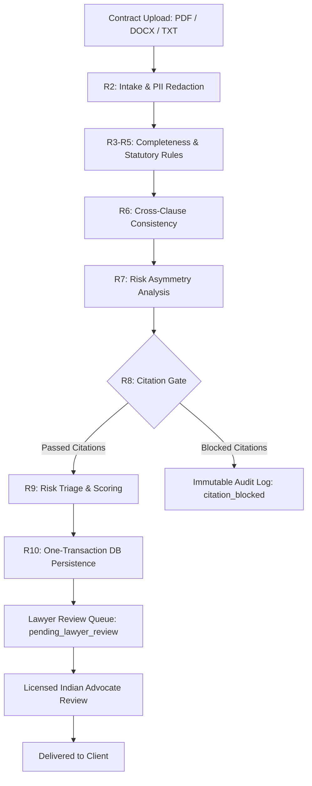
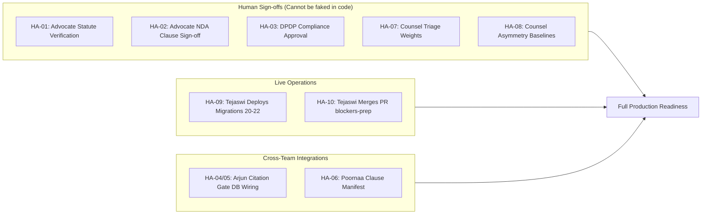

# AgentClause: Complete Architecture, History, Review Agent Deep Dive & Engineering Master Guide

**Document Version**: 2.0  
**Current Date**: 7 November 2026  
**Repository Branch**: `blockers-prep` (Commit `885c114`, ahead of `origin/main` at `41fbc94`)  
**Backend Test Suite**: **1001 passed, 38 skipped, 0 failed** in 7.80s  
**Target Audience**: Founding Engineers, Legal Tech Specialists, AI Researchers, Security & Compliance Officers

---

## Table of Contents
1. [Executive Overview & Vision](#1-executive-overview--vision)
2. [The Core Philosophy: Fail-Closed & Human-in-the-Loop](#2-the-core-philosophy-fail-closed--human-in-the-loop)
3. [Chronological Project History (Day 1 to 7 November 2026)](#3-chronological-project-history-day-1-to-7-november-2026)
4. [The Three Agent Architecture](#4-the-three-agent-architecture)
5. [Review Agent (R1–R11) Exhaustive Technical Breakdown](#5-review-agent-r1r11-exhaustive-technical-breakdown)
   - [R1: Unified Finding Schema & Data Contracts](#r1-unified-finding-schema--data-contracts)
   - [R2: Intake, Text Extraction & DPDP Redaction](#r2-intake-text-extraction--dpdp-redaction)
   - [R3: Completeness Checker & Multi-Contract Configurations](#r3-completeness-checker--multi-contract-configurations)
   - [R4 & R5: Statutory Rule Engine & Indian Legal Grounding](#r4--r5-statutory-rule-engine--indian-legal-grounding)
   - [R6: Cross-Clause Consistency Engine](#r6-cross-clause-consistency-engine)
   - [R7: Risk Asymmetry Engine & Org Normalization](#r7-risk-asymmetry-engine--org-normalization)
   - [R8: Citation Gate & Statutory Section Matching](#r8-citation-gate--statutory-section-matching)
   - [R9: Risk Triage & Queue Prioritization](#r9-risk-triage--queue-prioritization)
   - [R10: Pipeline Orchestration, Lifecycle & Recovery](#r10-pipeline-orchestration-lifecycle--recovery)
   - [R11: Evaluation, Synthetic Fixtures & Benchmarking](#r11-evaluation-synthetic-fixtures--benchmarking)
6. [Database Architecture & Complete Migration History (01–22)](#6-database-architecture--complete-migration-history-0122)
7. [Security, Identity & Infrastructure Engineering](#7-security-identity--infrastructure-engineering)
8. [Remaining Blockers & The Road to Production Readiness](#8-remaining-blockers--the-road-to-production-readiness)
9. [Essential Concepts & Knowledge Base for Engineers](#9-essential-concepts--knowledge-base-for-engineers)

---

## 1. Executive Overview & Vision

**AgentClause** is an enterprise AI contract review, drafting, and risk assessment platform purpose-built for the Indian legal ecosystem. Indian business contracts operate under a distinct statutory regime governed by century-old codified statutes (e.g., the *Indian Contract Act, 1872*, the *Code of Civil Procedure, 1908*), modern economic protection acts (e.g., the *Micro, Small and Medium Enterprises Development Act, 2006*), and emerging data privacy regulations (*Digital Personal Data Protection Act, 2023*).

Standard commercial LLMs natively trained on generic US/UK common law consistently hallucinate or misapply critical Indian legal tenets:
- They assume non-compete covenants during employment or post-termination can be "reasonable" (in India, post-employment non-competes are **void ab initio** under Section 27, ICA).
- They accept clauses where one party waives the right to go to civil court (in India, agreements in absolute restraint of legal proceedings are **void** under Section 28, ICA).
- They allow 90-day or 120-day commercial payment cycles (in India, Section 15 of the MSMED Act caps supplier payments at **45 days** and mandates compound interest at three times the RBI bank rate under Section 16).

AgentClause bridges this divide by deploying a multi-agent architecture coupled with deterministic statutory verification engines, cryptographic audit logging, and mandatory human advocate adjudication.

---

## 2. The Core Philosophy: Fail-Closed & Human-in-the-Loop

AgentClause is engineered under a strict **Fail-Closed** paradigm:
1. **Never Lie to the User**: If a statutory rule or completeness schema has not been verified by an enrolled Indian advocate, the engine must **never** return an empty findings list that implies the contract is clean. It skips unverified rules and explicitly returns:
   $$\text{review\_status} = \text{"no\_rules\_verified"} \quad \text{or} \quad \text{"partial\_unverified\_rules"}$$
2. **Write-Time Citation Screening**: The AI agents can propose findings, but the database will physically reject them via the Citation Gate (Layer 8) unless their citations resolve against verified statutes, certified clause baselines, or document manifests.
3. **Immutable Advocate Oversight**: No contract transitions to the `delivered` state without explicit advocate sign-off.
4. **Zero Unreviewed Live Changes**: Database migrations, security keys, and environment configs adhere to strict four-eyes review and scheduled deploy windows.



---

## 3. Chronological Project History (Day 1 to 7 November 2026)

### Phase 1: Foundation & Core Tenancy (Early to Mid-October 2026)
- **Multi-Tenant Isolation**: Established PostgreSQL schemas on Supabase (`ap-south-1` Mumbai) enforcing strict Row Level Security (RLS) across `organizations`, `users`, and `documents`.
- **Stateless Auth & Token Validation**: Configured Supabase Auth with custom role claims (`startup_user`, `lawyer`, `superadmin`).
- **File Storage**: Implemented AWS S3 integration with presigned uploads (`create_upload`) and presigned downloads (`create_download`) with 300-second TTLs, ensuring contract binaries never flow through application server memory.
- **Incident of 17 October**: Orphaned test artifacts under `orgs/org-test/` were discovered and safely purged. AWS bucket policies were hardened to forbid direct public access.

### Phase 2: Vector Search & Chunk Ingestion (24–26 October 2026)
- **Migration 19 (`document_chunks`)**: Successfully applied to live production on 26 October at 04:24:56 UTC (SHA-256: `4d9d5e3...`). Implemented 768-dimensional `pgvector` HNSW cosine indexing for clause semantic retrieval.
- **Chunk Access Service**: Delivered tenant-isolated chunk retrieval preventing cross-tenant leakage.

### Phase 3: The Security Hardening & Key Rotation (30 October – 2 November 2026)
- **30–31 October**: Live PostgreSQL database password rotated with Tejaswi's authorization.
- **31 October (PR #12 / Commit `44624ff`)**: Auth architecture hardened. The static `SUPABASE_JWT_SECRET` was deprecated; server code removed all HS256 validation routines to eliminate algorithm-confusion attacks. The backend exclusively verifies tokens via Supabase JWKS (ES256/RS256).
- **2 November**: All developer AWS IAM users and static access keys were permanently deleted. Production S3 access was transitioned exclusively to EC2/ECS instance profiles.

### Phase 4: Pipeline Integration & Rule Expansion (4 November 2026)
- **Commit `a465184`**: Merged Gemini-powered R2 intake normalization, R10 pipeline orchestrator, multi-contract completeness configurations (NDA, Vendor/Supplier, Founders' Agreement, SHA), and triage-tier sorting.
- **Migration 21 (`public.statutes`)**: Applied to live Supabase (Preflight passed 4/4).

### Phase 5: The Blocker-Prep Campaign (4–7 November 2026)
Engineered 10 mission-critical tasks on branch `blockers-prep`, scaling the test suite from 957 to **1001 passing tests**:
- **Task 1 (`b6a1746`)**: Relabeled synthetic benchmark fixtures to `sample_stub` and isolated them from real-world contract benchmarking aggregates.
- **Task 2 (`09a3431`)**: Implemented `normalize_statute_quote()` and automated dual-store parity assertions between `seed_statutes.json` and rule files, with store tracking in `advocate_review_pack.csv`.
- **Task 3 (`446244a`)**: Built atomic in-memory dual-store updates, rollback guards, and India Code URL validation in `apply_advocate_review.py`.
- **Task 4 (`08ec278`)**: Authored Migration 22 (`statutes_verified_guard` trigger) automatically demoting edited verified quotes to `staging`.
- **Task 5 (`5e61fcc`)**: Built `section_matches()` supporting `exact`, `subsection`, and `parent` hierarchical resolution while strictly blocking false positives. Hardened `verify_statute.py` and `load_statutes.py`.
- **Task 6 (`8c6ab46`)**: Hardened DPDP PII redaction protecting Indian currencies (`12,50,000`, `Rs. 5,00,000`), dates, and clause numbers, with retry on altered placeholders.
- **Task 7 (`42f933e`)**: Engineered safe failure surfaces: `side_unknown=True` when organization matching is ambiguous; `provisional=True` flags on interim weights; verified strict mode returns `review_status="no_rules_verified"`.
- **Task 8 (`35d85ce` / `eec4e08`)**: Handled deprecation of `ID_ALIAS_UNTIL`; permanently removed deprecated `id` alias in favor of canonical `finding_id` per Tejaswi's directive.
- **Task 9 (`7ed970b`)**: Created outreach briefing packs (`docs/outreach/`) and centralized tracking matrix (`docs/HUMAN_ACTIONS.md`).
- **Package Polish (`885c114`)**: Exported `section_matches` and `SectionMatchResult` from `app.statutes`.

---

## 4. The Three Agent Architecture

```
                                  AgentClause System
                                         │
         ┌───────────────────────────────┼───────────────────────────────┐
         ▼                               ▼                               ▼
   Review Agent                   Drafting Agent               Conversational Agent
     (R1–R11)                         (D1–D8)                         (C1–C9)
 • Contract parsing               • Clause assembly              • Post-review Q&A
 • PII Redaction                  • Playbook variance            • Chunk vector search
 • Statutory engine               • Startup fallback             • Conversational chat
 • Asymmetry & triage             • Manifest emission            • Strict tenant boundary
 • Citation gating                • Fixture stubs (demo)         • Grounded citations
```

### Document State Machine

The document state machine enforces strict lifecycle transitions:

```
[drafted] ──(start_review)──> [under_ai_review] ──(run_pipeline success)──> [pending_lawyer_review]
    ▲                                │
    │                                └──(LayerFailed / stale)──> [drafted / revision_in_progress]
    │                                                                   (Audit: ai_review_failed)
[revision_in_progress] <──(lawyer_commented)── [pending_lawyer_review]
                                                       │
                                                       └──(lawyer_approved)──> [delivered]
```

---

## 5. Review Agent (R1–R11) Exhaustive Technical Breakdown

### R1: Unified Finding Schema & Data Contracts
- **Location**: `backend/app/schemas/finding.py`, `backend/app/findings/`
- **Purpose**: Defines the universal schema contract for findings across all pipeline layers.
- **Core Model**: `Finding`
  - `finding_id`: UUID (canonical identifier; deprecated `id` alias permanently removed per Tejaswi's decision).
  - `document_id`, `document_version_id`: Tenancy and version bindings.
  - `layer`: Enum (`COMPLETENESS`, `STATUTORY`, `CONSISTENCY`, `RISK_ASYMMETRY`).
  - `severity`: Enum (`CRITICAL`, `HIGH`, `MEDIUM`, `LOW`, `INFO`).
  - `rule_applied`: Versioned rule identifier (e.g., `ICA_1872_S27_POST_TERM_NON_COMPETE@1`).
  - `clause_reference`: Human-readable clause pointer (`"Clause 8.2"`).
  - `quote`: Verbatim excerpt from contract text.
  - `description`: Plain-language legal analysis of the risk.
  - `citation_type`: Enum (`STATUTORY`, `CASE`, `CORPUS`, `INTERNAL_BASELINE`).
  - `citation`: Formal legal citation string (`"Indian Contract Act, 1872, s. 27"`).
  - `origin`: Enum (`AGENT`, `ADVOCATE`). Advocate-origin findings are exempt from citation gating.

---

### R2: Intake, Text Extraction & DPDP Redaction
- **Location**: `backend/app/intake/service.py`, `backend/app/agents/conversational/ingest.py`
- **Text Extraction**: Extracts clean text from PDF (via `pypdf`), DOCX (via `python-docx`), and plain text (`.txt`).
- **Clause Segmentation**: Regex parser identifies clause numbering hierarchies (`CLAUSE_RE = r"^\s*(?:(?:clause|section|article)\s+)?(\d+(?:\.\d+)+\.?|\d+[.)])\s+(\S.*)$"`).
- **DPDP PII Redaction (`INTAKE_REDACT_PII`)**:
  - Before sending text to external LLMs (Google Gemini 1.5/2.0), sensitive personal data is redacted into reversible tokens:
    - **PAN**: `[A-Z]{5}[0-9]{4}[A-Z]{1}` $\rightarrow$ `[PAN_1]`
    - **Aadhaar**: `\b[2-9]\d{3}\s\d{4}\s\d{4}\b` $\rightarrow$ `[AADHAAR_1]`
    - **Phone**: `(?:(?:\+91|91|0)[- ]?)?[6-9]\d{9}` $\rightarrow$ `[PHONE_1]`
    - **Email**: Standard RFC 5322 regex $\rightarrow$ `[EMAIL_1]`
    - **Bank Accounts & IFSC**: `[A-Z]{4}0[A-Z0-9]{6}` $\rightarrow$ `[IFSC_1]`
    - **GSTIN**: `\d{2}[A-Z]{5}\d{4}[A-Z]{1}[A-Z\d]{1}[Z]{1}[A-Z\d]{1}` $\rightarrow$ `[GST_1]`
  - **Context-Guard Filters**: Explicitly prevents corrupting Indian currency expressions (`Rs. 5,00,000`, `12,50,000`), clause numbering (`1.`, `2.1`), dates (`2026-10-15`), and invoice numbers (`INV-2026-001`).
  - **Round-Trip Restoration**: Restores redacted values upon LLM response.
  - **Token Drift Retry**: Detects altered or shifted tokens (`[PAN_1]` returned as `[PAN_2]`) and triggers an automatic retry.
  - **Verbatim Substring Check**: Asserts that every quoted finding exists character-for-character in the original unredacted text.

---

### R3: Completeness Checker & Multi-Contract Configurations
- **Location**: `backend/app/rules/completeness.py`, `backend/app/rules/config/`
- **Configurations Supported**:
  1. `nda_required_clauses.json` (8 core clauses: Definition, Confidentiality Obligations, Exclusions, Term, Return/Destruction, Governing Law, Dispute Resolution, Indemnity).
  2. `vendor_supplier_required_clauses.json` (Payment terms, MSME compliance, Termination, Liability, Warranty).
  3. `founders_agreement_required_clauses.json` (Equity vesting, IP assignment, Reverse vesting, Drag-along).
  4. `sha_required_clauses.json` (Board composition, Transfer restrictions, Pre-emption rights, Information covenants).
- **Coverage & Review Status**:
  - Computes `rules_total`, `rules_evaluated`, `rules_skipped_unverified`.
  - In strict mode, if completeness config is unverified, skips rules with `SkipReason.UNVERIFIED_IN_STRICT_MODE` and reports:
    $$\text{review\_status} = \text{"no\_rules\_verified"}$$

---

### R4 & R5: Statutory Rule Engine & Indian Legal Grounding
- **Location**: `backend/app/rules/engine.py`, `backend/app/rules/rules/`, `backend/app/rules/config/seed_statutes.json`
- **Temporal Versioning**: Every rule defines `valid_from` and `valid_to`. Evaluations run against contract `effective_date` (or today in India). Gaps trigger `RuleGapError`.
- **7 Seed Indian Statutory Rules**:
  1. `ICA_1872_S27_POST_TERM_NON_COMPETE`: Post-termination non-compete void under Section 27, ICA (*Percept D'Mark v. Zaheer Khan*). Severity: **CRITICAL**.
  2. `ICA_1872_S28_JURISDICTION_EXCLUSION`: Absolute exclusion of court jurisdiction or shortening limitation periods void under Section 28, ICA. Severity: **HIGH**.
  3. `ICA_1872_S74_UNREASONABLE_LIQUIDATED_DAMAGES`: Unreasonable penalties masquerading as liquidated damages restricted to reasonable compensation under Section 74, ICA (*Kailash Nath Associates v. DDA*). Severity: **MEDIUM**.
  4. `MSMED_2006_S15_PAYMENT_PERIOD`: Buyer-supplier payment terms exceeding 45 days void under Section 15, MSMED Act 2006. Severity: **HIGH**.
  5. `MSMED_2006_S16_COMPOUND_INTEREST`: Mandatory compound interest at 3x RBI bank rate for delayed MSME payments; clauses attempting waiver are void. Severity: **HIGH**.
  6. `CPC_1908_S20_JURISDICTION_WITHOUT_NEXUS`: Conferred jurisdiction on courts where neither party resides nor cause of action arises is invalid under Section 20, CPC. Severity: **MEDIUM**.
  7. `ICA_1872_S23_PUBLIC_POLICY_INDEMNITY`: Indemnities covering criminal acts or deliberate illegalities void under Section 23, ICA. Severity: **CRITICAL**.
- **Dual-Store Parity**: `test_statutes.py` strictly asserts normalized quote equivalence between rule JSON definitions and `seed_statutes.json`.

---

### R6: Cross-Clause Consistency Engine
- **Location**: `backend/app/pipeline/consistency.py`
- **Purpose**: Detects internal contractual contradictions across distinct clauses.
- **Core Checks**:
  - Governing law vs Dispute seat (e.g., Indian substantive law vs foreign jurisdiction without arbitration mechanism).
  - Confidentiality period vs Contract term (obligations terminating before disclosure period ends).
  - IP assignment vs License-back grant conflicts.
- **Interim Guard**: Severities are capped at `LOW` while config remains `status: "PLACEHOLDER"`.

---

### R7: Risk Asymmetry Engine & Org Normalization
- **Location**: `backend/app/pipeline/asymmetry.py`
- **Org-Name Normalization (`normalize_org_name`)**:
  - Strips honorifics and business prefixes (`M/s`, `Shri`, `Messrs`).
  - Canonicalizes corporate suffixes: `Pvt Ltd`, `Private Limited`, `Ltd.`, `Limited`, `LLP`, `Inc.`, `Corp.`.
  - Replaces `&` with `and`, collapses punctuation and whitespace.
- **Conservative Fuzzy Matching**:
  - Matches contract party strings to user's registered organization.
  - Employs high threshold (85%+) with conservative token-set matching.
  - **Ambiguity Guard**: If multiple parties match or confidence is low, returns `side_unknown=True`, sets score to `0.0`, and logs the event without guessing.
- **Scoring Logic**:
  - Evaluates unilateral obligations (unilateral indemnity, unilateral termination for convenience, uncapped liability on startup vs capped on enterprise).
  - Multiplies provision weights from `asymmetry.json`. Output score: $0.0 \le S \le 1.0$.

---

### R8: Citation Gate & Statutory Section Matching
- **Location**: `backend/app/agents/citation_gate.py`, `backend/app/statutes/normalizer.py`
- **Write-Time Interception**: Every finding emitted by an agent must pass `screen_findings()`. Blocked findings are purged and written to `audit_logs` (`citation_blocked`).
- **Citation Types**:
  - `STATUTORY`: Matches `<Act>, <year>, s. <section>` against verified corpus.
  - `CASE`: Verified court precedents.
  - `CORPUS`: Certified clause library IDs.
  - `INTERNAL_BASELINE`: Manifest-grounded cross-clause references.
- **Section Match Engine (`section_matches`)**:
  - Evaluates hierarchical section parity:
    - `'exact'`: `27` == `27`, `27(1)` == `27(1)`.
    - `'subsection'`: citation `27` matches stored `27(1)`.
    - `'parent'`: citation `27(1)` matches stored base `27`.
  - **False Positive Defense**: Strictly blocks false matches (e.g., `27` vs `270`, `27` vs `27A`, `27(1)` vs `27(2)`).

---

### R9: Risk Triage & Queue Prioritization
- **Location**: `backend/app/pipeline/triage.py`
- **Triage Tiers**:
  - `tier_1_urgent`: Critical statutory violations (Section 27 non-compete, void terms) or high asymmetry score ($S \ge 0.7$).
  - `tier_2_standard`: Moderate defects (missing standard clauses, high severities).
  - `tier_3_routine`: Minor deviations, procedural gaps.
- **Provisional Guard**: Flags `provisional=True` in queue payload while `triage.json` weights are marked `status: "PLACEHOLDER"`.

---

### R10: Pipeline Orchestration, Lifecycle & Recovery
- **Location**: `backend/app/pipeline/runner.py`, `backend/app/main.py`
- **Lifecycle Flow**:
  1. `POST /documents/{id}/review` $\rightarrow$ checks state $\rightarrow$ transitions to `under_ai_review`.
  2. Spawns background worker `run_pipeline(document_id, version_id, from_state)`.
  3. Executes layers R2 through R9 sequentially.
  4. In a single atomic database transaction:
     - Deletes previous agent findings (preserves advocate-added findings).
     - Inserts passed findings.
     - Saves triage tier and asymmetry score.
     - Writes comprehensive audit trail with layer execution times.
     - Transitions state to `pending_lawyer_review`.
  5. **Failure & Rollback**: Any unhandled exception reverts document to `from_state` and logs `ai_review_failed`.
  6. **Process Crash Recovery (`recover_stale_reviews`)**: On FastAPI server startup/lifespan, any documents left orphaned in `under_ai_review` across restarts are automatically restored to their previous state.

---

### R11: Evaluation, Synthetic Fixtures & Benchmarking
- **Location**: `backend/tests/fixtures/contracts/`, `scripts/benchmark_public_contracts.py`
- **Synthetic Fixture Triples**:
  - `nda_bad`: Planted defects (unilateral indemnity, perpetual non-disclosure, post-term non-compete). Catches all planted defects.
  - `nda_clean`: Clean contract without defects. Zero false positives.
  - `vendor_msme`: 90-day payment term and interest waiver. Planted MSMED Act violations flagged accurately.
- **Public Benchmark Provenance**: `sample_stub` isolated from real contract aggregate metrics to guarantee benchmark integrity.

---

## 6. Database Architecture & Complete Migration History (01–22)

```
Supabase PostgreSQL 17.11 (ap-south-1, Mumbai)
 ├── pgvector Extension (v0.8.2)
 ├── Row Level Security (RLS) on all tables
 └── Revoked public anon/authenticated grants
```

| Migration File | Description & Technical Implementation | Live Status |
|---|---|---|
| `01_initial_schema.sql` | Core tenancy: `organizations`, `users`, `user_roles`. | **Applied on Live** |
| `02_documents.sql` | `documents` table with state machine enum. | **Applied on Live** |
| `03_audit_logs.sql` | Append-only `audit_logs` table with actor context. | **Applied on Live** |
| `04_document_versions.sql` | Immutable `document_versions` and S3 storage keys. | **Applied on Live** |
| `05_clauses.sql` | Clause segmentation and initial embedding storage. | **Applied on Live** |
| `06_findings.sql` | Universal `findings` table with origin and citations. | **Applied on Live** |
| `07_playbooks.sql` | Drafting playbook rules and enterprise baselines. | **Applied on Live** |
| `08_comments.sql` | Lawyer review annotations and commenting threads. | **Applied on Live** |
| `09_tags.sql` | Document categorization and metadata tags. | **Applied on Live** |
| `10_invites.sql` | Multi-user team invitations and onboarding tokens. | **Applied on Live** |
| `11_exports.sql` | Export audit tracking for PDF/DOCX downloads. | **Applied on Live** |
| `12_auth_hardening.sql` | Custom claims and JWT tenant isolation triggers. | **Applied on Live** |
| `13_storage_policies.sql` | Internal storage access policies. | **Applied on Live** |
| `14_model_tracking.sql` | Model versioning columns on embeddings. | **Applied on Live** |
| `15_review_queues.sql` | Lawyer review assignment and triage views. | **Applied on Live** |
| `16_triage_scoring.sql` | `documents.triage_tier` and scoring columns. | **Applied on Live** |
| `17_case_law.sql` | Case-law citation lookup table schema. | **Applied on Live** |
| `18_asymmetry_tables.sql` | Asymmetry score storage and provision matrix. | **Applied on Live** |
| `19_document_chunks.sql` | `document_chunks` table, `vector(768)` HNSW index, check triggers. | **Applied on Live** |
| `20_constraint_fix.sql` | Idempotent constraint drop-and-add fix. | **Scheduled Deploy** |
| `21_statutes.sql` | `public.statutes` table (`staging` vs `verified`, India Code URLs). | **Applied on Live** |
| `22_statutes_verified_guard.sql` | `statutes_verified_guard` BEFORE UPDATE trigger demoting modified verified quotes to `staging`. | **Prepared (File Only)** |

---

## 7. Security, Identity & Infrastructure Engineering

### Key Rotation & Credential Posture
1. **Database Credentials**: PostgreSQL password rotated on 30–31 October with authorization.
2. **JWT Secret & Algorithm Enforcement**:
   - Pinned algorithms: ES256 / RS256 via Supabase JWKS.
   - HS256 tokens are explicitly refused in code (`test_token_leeway.py`).
   - Legacy JWT secret removed from code and settings.
3. **AWS S3 IAM Architecture**:
   - Zero local AWS credentials on developer machines.
   - Developer IAM user and access keys permanently deleted on 2 November.
   - Server authenticates strictly via **EC2/ECS instance profile**.
   - S3 bucket has **Block Public Access enabled** across all 4 controls.
   - All client reads/writes use short-lived presigned URLs (300s TTL).
4. **Scheduled Legacy Key Disable Window**:
   - Legacy Supabase keys (`anon` / `service_role`) scheduled for disable during tonight's **19:00–20:00 IST** window.
   - Disabling is completely reversible via the Supabase Dashboard under *Project Settings $\rightarrow$ API*. Permanent revocation occurs after verification.

---

## 8. Remaining Blockers & The Road to Production Readiness

Every engineering blocker that can be resolved in code is complete. Production deployment is gated solely on **human actions, legal verifications, and live migration operations** (tracked in `docs/HUMAN_ACTIONS.md`):



### Master Human Actions Matrix

| Item # | Owner | Required Action | Blocking Impact | Prepared Deliverable / Tool |
|:---:|:---|:---|:---:|:---|
| **HA-01** | **Advocate (Legal Counsel)** | Verify 7 statutory seed quotes against India Code in CSV. | Strict mode R4/R5 | [`docs/advocate_review_pack.csv`](file:///Users/manojmj/Agentclause/docs/advocate_review_pack.csv)<br>[`scripts/apply_advocate_review.py`](file:///Users/manojmj/Agentclause/scripts/apply_advocate_review.py) |
| **HA-02** | **Advocate (Legal Counsel)** | Sign off on mandatory NDA required clauses. | Strict mode R3 | [`nda_required_clauses.json`](file:///Users/manojmj/Agentclause/backend/app/rules/config/nda_required_clauses.json) |
| **HA-03** | **Compliance / DPO** | Sign off on DPDP Section 16 data transit & customer notice. | Enterprise R2 intake | [`docs/dpdp_intake_note.md`](file:///Users/manojmj/Agentclause/docs/dpdp_intake_note.md) |
| **HA-04** | **Arjun** | Wire Citation Gate to `public.statutes` table via SQL. | Citation Gate R8 | [`docs/statutes_matching_rule.md`](file:///Users/manojmj/Agentclause/docs/statutes_matching_rule.md)<br>[`app.statutes.section_matches`](file:///Users/manojmj/Agentclause/backend/app/statutes/normalizer.py) |
| **HA-05** | **Arjun** | Implement citation token extraction from finding text. | Citation Gate R8 | [`docs/outreach/arjun.md`](file:///Users/manojmj/Agentclause/docs/outreach/arjun.md) |
| **HA-06** | **Poornaa** | Deliver structured clause manifest schema for versions. | R6/R7 Gate Passing | [`docs/outreach/poornaa.md`](file:///Users/manojmj/Agentclause/docs/outreach/poornaa.md) |
| **HA-07** | **Partner Counsel** | Calibrate triage severity points and tier cutoffs. | Production R9 Triage | [`backend/app/pipeline/config/triage.json`](file:///Users/manojmj/Agentclause/backend/app/pipeline/config/triage.json) |
| **HA-08** | **Partner Counsel** | Calibrate provision weights and market baselines. | Production R7 Asymmetry | [`backend/app/pipeline/config/asymmetry.json`](file:///Users/manojmj/Agentclause/backend/app/pipeline/config/asymmetry.json) |
| **HA-09** | **Tejaswi** | Deploy migrations 20, 21, and 22 during scheduled window. | Live Database | [`20261105100000_22_statutes_verified_guard.sql`](file:///Users/manojmj/Agentclause/supabase/migrations/20261105100000_22_statutes_verified_guard.sql) |
| **HA-10** | **Tejaswi** | Review and merge PR `blockers-prep` into `main`. | Code Integration | [Pull Request Link](https://github.com/mmanoj770/Agentclause/pull/new/blockers-prep) |
| **HA-11** | **Engineering** | Deprecate Finding `id` alias before 15 November 2026. | Schema Cleanup | [`backend/tests/test_finding_views.py`](file:///Users/manojmj/Agentclause/backend/tests/test_finding_views.py) |

---

## 9. Essential Concepts & Knowledge Base for Engineers

Every engineer joining or contributing to AgentClause must master these five pillars:

### Pillar 1: Indian Contract Law Essentials
- **Section 27, Indian Contract Act 1872**: Every agreement by which anyone is restrained from exercising a lawful profession, trade, or business of any kind is **to that extent void**. In India, there is no "reasonableness" exception for post-employment restrictions.
- **Section 28, Indian Contract Act 1872**: Agreements that absolutely restrict a party from enforcing contractual rights in ordinary tribunals or that shorten the statutory limitation period (governed by the *Limitation Act, 1963*) are void.
- **Section 74, Indian Contract Act 1872**: Liquidated damages clauses do not grant an automatic right to the stipulated sum. The aggrieved party is entitled only to reasonable compensation not exceeding the penalty amount (*Kailash Nath Associates v. DDA*).
- **Sections 15 & 16, MSMED Act 2006**: Where a supplier is an MSME, the payment period agreed upon cannot exceed **45 days** from the day of acceptance. Delayed payments incur mandatory compound interest with monthly rests at **three times the Bank Rate** notified by the Reserve Bank of India.

### Pillar 2: Security & Credential Hygiene
- **Never Hold Static AWS Credentials**: The application must never rely on local developer IAM credentials. All AWS S3 calls must originate from instance profiles or presigned client URLs.
- **Algorithm Confusion Defense**: Never allow JWT verification to fall back to symmetric HS256 when using an asymmetric public key provider like Supabase Auth.
- **Audit Logging Immutability**: Critical security events (`citation_blocked`, `ai_review_failed`, `state_change`) must write to dedicated audit connections that do not roll back when business transactions fail.

### Pillar 3: Deterministic vs Probabilistic Layer Separation
- **Intake and Extraction** are probabilistic (handled by LLMs like Gemini).
- **Rule Verification and Citation Gating** are strictly deterministic (handled by Python AST, regexes, and database equality checks).
- An LLM must **never** decide whether a statute is verified or whether a finding passes the Citation Gate.

### Pillar 4: Privacy & DPDP Compliance
- **Data Minimization**: Never transit raw unredacted personal identifiers (PAN, Aadhaar, bank credentials) to external LLM provider endpoints.
- **Verbatim Integrity**: Client-side redaction must guarantee that restored substrings perfectly align character-for-character with the original contract text to allow legally binding citations.

### Pillar 5: Test-Driven Rigor in LegalTech
- **Access Tests**: Role-separation tests must be executed with live tokens or flagged explicitly.
- **Mutation & Parity Testing**: Statutory quotes in rule files must continuously match database seed configurations via automated regression tests.
- **Zero Failures Rule**: PRs and commits are blocked unless the full test suite runs 100% green with zero test failures.
